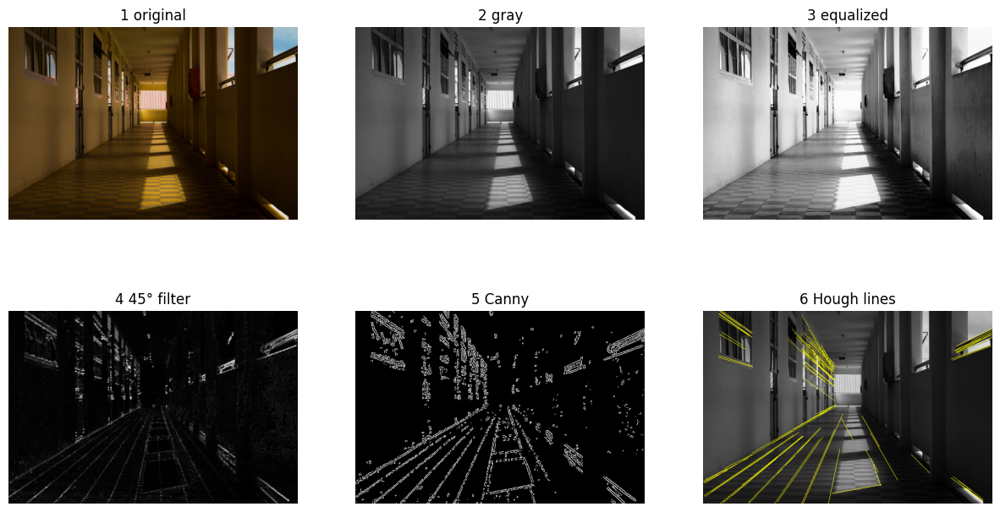
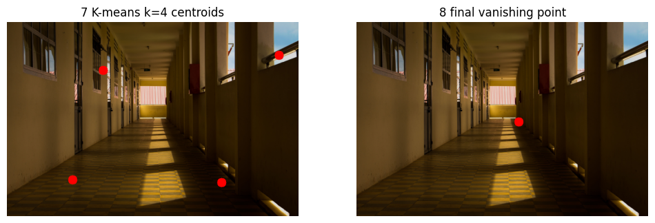
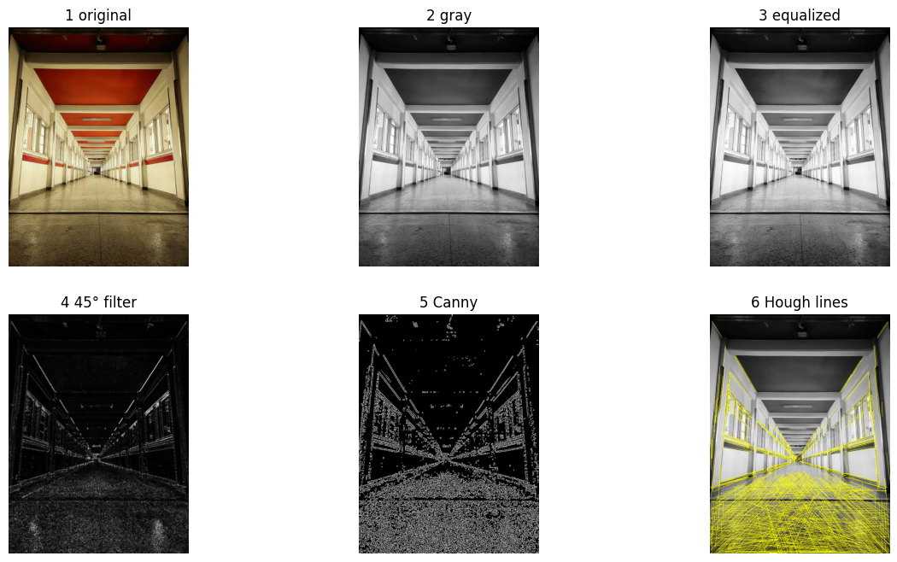
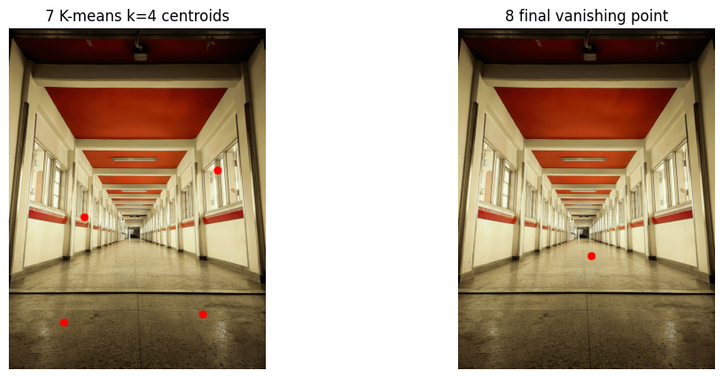
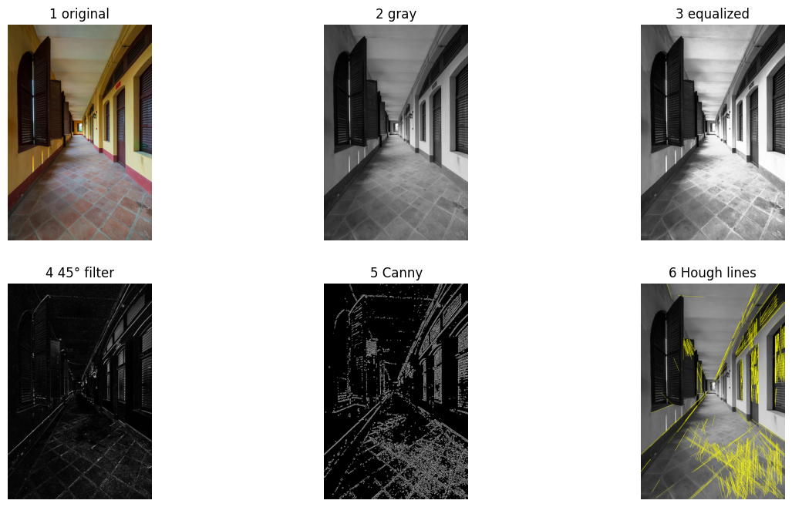
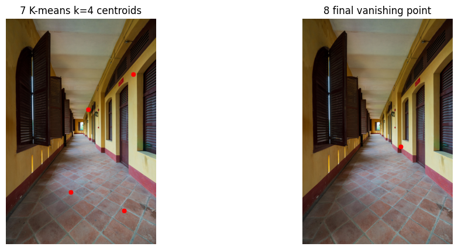

# A1: Vanishing point detection in corridors

## Priebeh vypracovania úlohy 
Implementoval som algoritmus z článku Ebrahimpour et al. (2012) v Pythone cez Google Colab (OpenCV, NumPy, matplotlib):
1. Načítanie obrázka a zmenšenie na šírku 640 px
2. Šedotónová konverzia
3. Ekvalizácia histogramu
4. 45° maska (3×3 jadro `[[-1,-1,2],[-1,2,-1],[2,-1,-1]]`, `filter2D` + `convertScaleAbs`)
5. Cannyho detektor hrán
6. `HoughLinesP` na získanie čiar
7. K-means (k=4) na koncových bodoch čiar, centroidy vykreslené do obrázka
8. K-means (k=1) na 4 centroidoch, výsledok je odhad vanishing pointu

Čiastkové výsledky (po každom kroku) aj finálny obrázok sú v notebooku a v súboroch `result_parts.png` a `result_final.png`.

## Výsledky

### Chodba 1 

### Chodba 2

### Chodba 3

## Zhodnotenie výsledkov
Čiary pozdĺž stien a stropu sa detegujú správne a smerujú k vanishing pointu. Výsledný bod je však na mojich obrázkoch posunutý, pretože textúra podlahy, okná a zábradlie vytvárajú veľa ďalších čiar a K-means na koncových bodoch ich nevie odlíšiť od hrán chodby. 

## Použitie AI
Použil som Claude na ladenie a vysvetlenie chýb, ladenie parametrov, pomoc pri zhodnotení výsledkov a zapísanie README.
